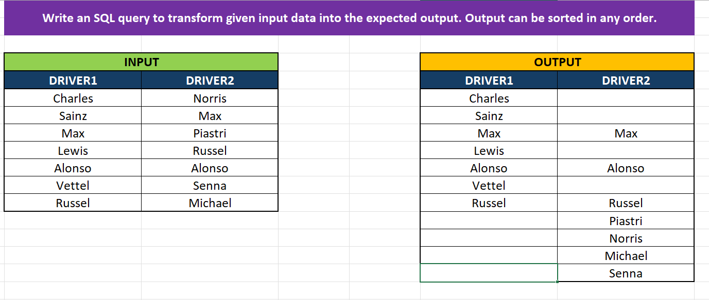
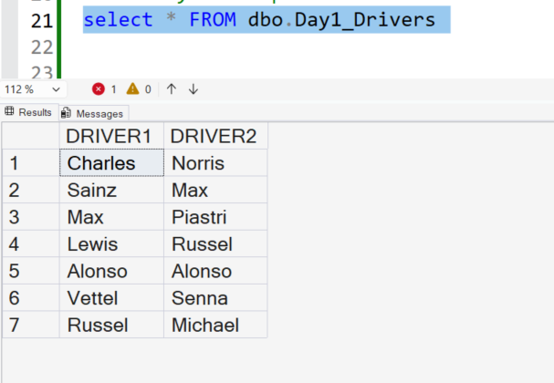
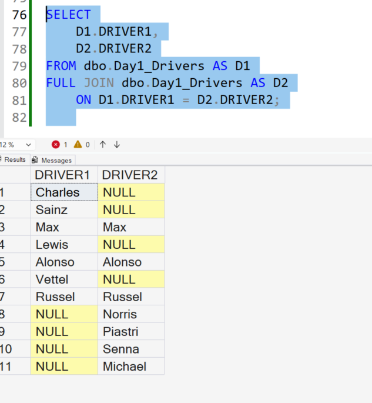

# Day 01 — Drivers Problem | SQL Practice

## 📌 Overview
A SQL Server practice problem focused on matching driver names across two columns and identifying unmatched values.

## 🎯 Objective
Compare `DRIVER1` and `DRIVER2` to reproduce the expected output while retaining matched and unmatched records.

## 📷 Problem Statement


## 📊 Input Data


## 💡 Approach
- Analysed the input data and expected output.
- Identified the matching condition between `DRIVER1` and `DRIVER2`.
- Used a **self-join** to compare the table against itself.
- Applied a **FULL JOIN** to retain matched and unmatched rows from both sides.

## 💻 SQL Solution

```sql
SELECT
    D1.DRIVER1,
    D2.DRIVER2
FROM dbo.Day1_Drivers AS D1
FULL JOIN dbo.Day1_Drivers AS D2
    ON D1.DRIVER1 = D2.DRIVER2;
```

## ✅ Query Output


## 🧠 Key Learnings
- Self-joins and table aliases.
- `FULL JOIN` behaviour.
- Matching values across columns.
- Understanding `NULL` values in unmatched rows.

## 🛠️ Tools
- Microsoft SQL Server
- SQL Server Management Studio (SSMS)
- Visual Studio Code
- Git and GitHub

## 📍 Status
**Status:** Practised and executed in SSMS.