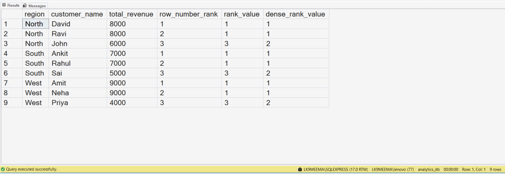
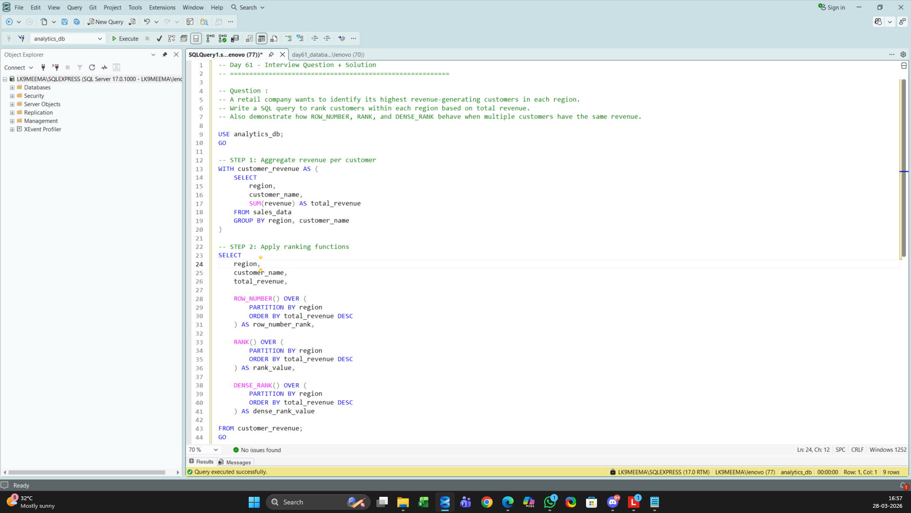

# Customer Ranking by Region Using SQL Window Functions

## Business Scenario

A retail company wants to identify its highest-revenue customers within each region.

## Analysis Objective

Rank customers within regions and compare ROW_NUMBER, RANK, and DENSE_RANK.

## SQL Concepts Practiced

- Common Table Expressions (CTEs)
- GROUP BY and SUM
- ROW_NUMBER(), RANK(), and DENSE_RANK()
- PARTITION BY and ORDER BY
- Top N per group analysis

## Query and Setup

- [database_table_setup.sql](database_table_setup.sql) — database and table setup.
- [question_solution_window_ranking.sql](question_solution_window_ranking.sql) — SQL solution.

## Execution Evidence

### Output Result

### Query Execution

## Business Insight

Ranking functions handle ties differently. The appropriate function depends on whether unique positions, skipped ranks, or consecutive ranks are required.

## Project Files

- [database_table_setup.sql](database_table_setup.sql)
- [output_result.png](output_result.png)
- [query_execution.png](query_execution.png)
- [question_solution_window_ranking.sql](question_solution_window_ranking.sql)

## Tools Used

- Microsoft SQL Server
- SQL Server Management Studio (SSMS)

---

This case study is part of my SQL business-case and interview-practice portfolio.
