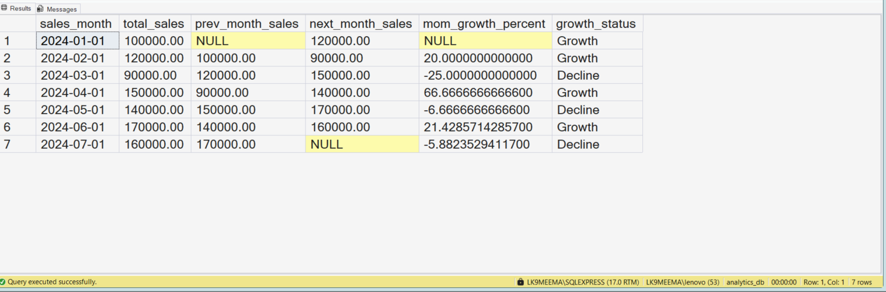
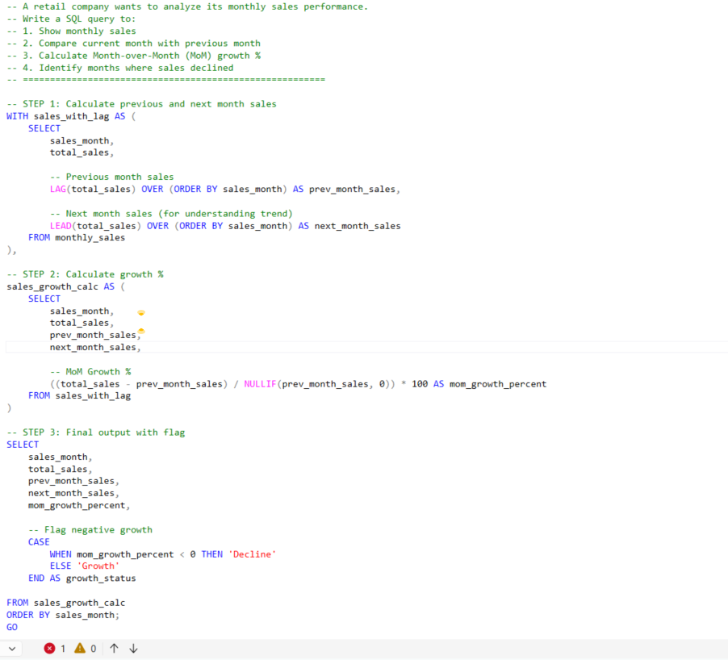

# Period-over-Period Growth Analysis Using LAG and LEAD

## Business Scenario

A business wants to compare performance across consecutive periods.

## Analysis Objective

Use LAG and LEAD to access previous and subsequent rows and calculate changes between periods.

## SQL Concepts Practiced

- LAG()
- LEAD()
- Window functions
- Period comparisons
- Growth calculations

## Query and Setup

- [database_table_setup.sql](database_table_setup.sql) — database and table setup.
- [question_solution_lag_lead_growth.sql](question_solution_lag_lead_growth.sql) — SQL solution.

## Execution Evidence

### Output Result

### Query Execution

## Business Insight

LAG and LEAD help compare a row with another row without joining the table to itself.

## Project Files

- [database_table_setup.sql](database_table_setup.sql)
- [output_result.png](output_result.png)
- [query_execution.png](query_execution.png)
- [question_solution_lag_lead_growth.sql](question_solution_lag_lead_growth.sql)

## Tools Used

- Microsoft SQL Server
- SQL Server Management Studio (SSMS)

---

This case study is part of my SQL business-case and interview-practice portfolio.
