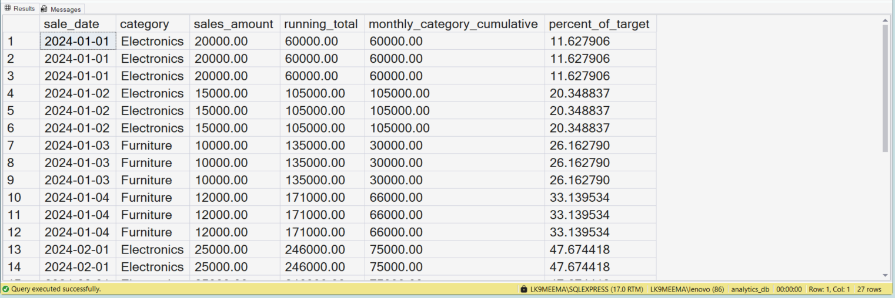
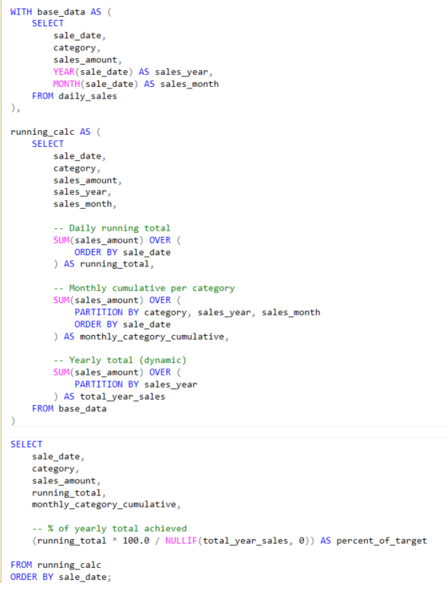

# Running Totals and Cumulative Analysis Using SQL

## Business Scenario

A business wants to understand how revenue accumulates over time.

## Analysis Objective

Calculate cumulative values using window functions and an appropriate ordering.

## SQL Concepts Practiced

- SUM() OVER()
- PARTITION BY
- ORDER BY
- Running totals
- Cumulative metrics

## Query and Setup

- [database_table_setup.sql](database_table_setup.sql) — database and table setup.
- [question_solution_running_totals.sql](question_solution_running_totals.sql) — SQL solution.

## Execution Evidence

### Output Result

### Query Execution

## Business Insight

Running totals reveal how a metric accumulates over time and can help monitor business performance.

## Project Files

- [database_table_setup.sql](database_table_setup.sql)
- [output_result.png](output_result.png)
- [query_execution.png](query_execution.png)
- [question_solution_running_totals.sql](question_solution_running_totals.sql)

## Tools Used

- Microsoft SQL Server
- SQL Server Management Studio (SSMS)

---

This case study is part of my SQL business-case and interview-practice portfolio.
