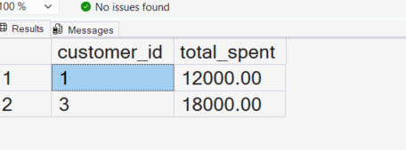
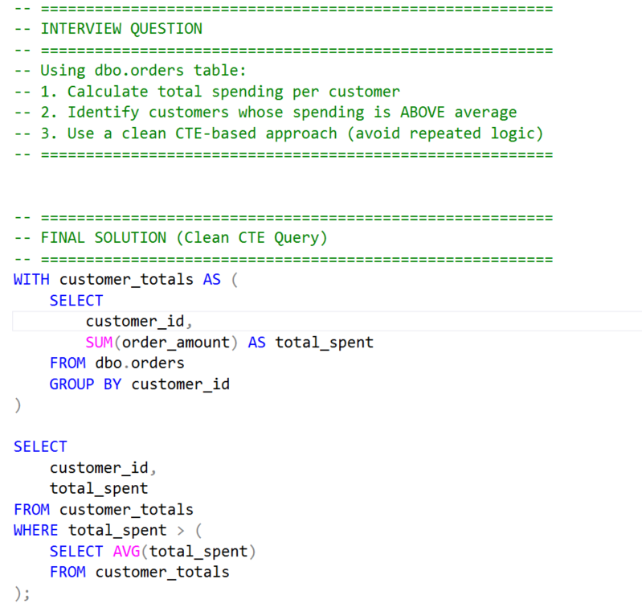

# Writing Readable SQL Queries Using CTEs

## Business Scenario

An analyst needs to make a multi-step SQL analysis easier to understand and maintain.

## Analysis Objective

Break a query into logical stages using Common Table Expressions.

## SQL Concepts Practiced

- WITH clause
- CTEs
- Query decomposition
- Aggregation
- Readable SQL

## Query and Setup

- [database_table_setup.sql](database_table_setup.sql) — database and table setup.
- [question_solution_ctes_clean_code.sql](question_solution_ctes_clean_code.sql) — SQL solution.

## Execution Evidence

### Output Result

### Query Execution

## Business Insight

CTEs can make complex queries easier to follow by separating the logic into meaningful steps.

## Project Files

- [database_table_setup.sql](database_table_setup.sql)
- [output_result.png](output_result.png)
- [query_execution.png](query_execution.png)
- [question_solution_ctes_clean_code.sql](question_solution_ctes_clean_code.sql)

## Tools Used

- Microsoft SQL Server
- SQL Server Management Studio (SSMS)

---

This case study is part of my SQL business-case and interview-practice portfolio.
