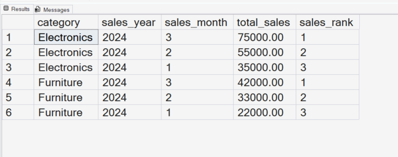

# Solving Complex Business Problems Using SQL CTEs

## Business Scenario

A business problem requires several intermediate calculations before producing the final result.

## Analysis Objective

Combine multiple query stages to solve a multi-step analytical problem.

## SQL Concepts Practiced

- Multiple CTEs
- Joins
- Aggregations
- Conditional logic
- Query structure

## Query and Setup

- [database_table_setup.sql](database_table_setup.sql) — database and table setup.
- [question_solution_ctes_complex.sql](question_solution_ctes_complex.sql) — SQL solution.

## Execution Evidence

### Output Result

### Query Execution

## Business Insight

Breaking a complex problem into stages makes the logic easier to test and maintain.

## Project Files

- [database_table_setup.sql](database_table_setup.sql)
- [output_result.png](output_result.png)
- [query_execution.png](query_execution.png)
- [question_solution_ctes_complex.sql](question_solution_ctes_complex.sql)

## Tools Used

- Microsoft SQL Server
- SQL Server Management Studio (SSMS)

---

This case study is part of my SQL business-case and interview-practice portfolio.
