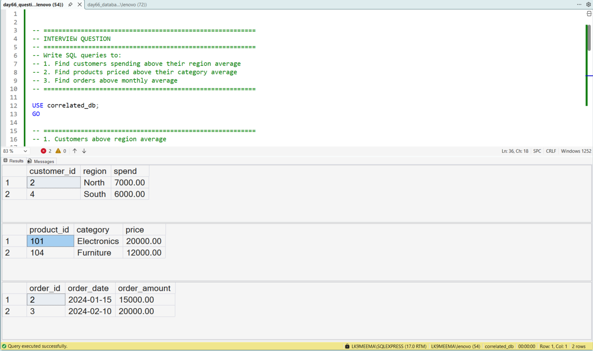
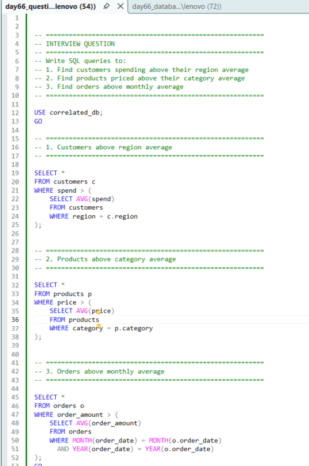

# Correlated Subqueries for Business Analysis

## Business Scenario

An analyst needs to compare individual records with values calculated from related records.

## Analysis Objective

Understand how a subquery references columns from its outer query.

## SQL Concepts Practiced

- Correlated subqueries
- Outer queries
- Inner queries
- Filtering
- Row-level comparisons

## Query and Setup

- [database_table_setup.sql](database_table_setup.sql) — database and table setup.
- [question_solution_correlated.sql](question_solution_correlated.sql) — SQL solution.

## Execution Evidence

### Output Result

### Query Execution

## Business Insight

Correlated subqueries can express row-dependent comparisons, although joins or window functions may be more efficient for some problems.

## Project Files

- [database_table_setup.sql](database_table_setup.sql)
- [output_result.png](output_result.png)
- [query_execution.png](query_execution.png)
- [question_solution_correlated.sql](question_solution_correlated.sql)

## Tools Used

- Microsoft SQL Server
- SQL Server Management Studio (SSMS)

---

This case study is part of my SQL business-case and interview-practice portfolio.
