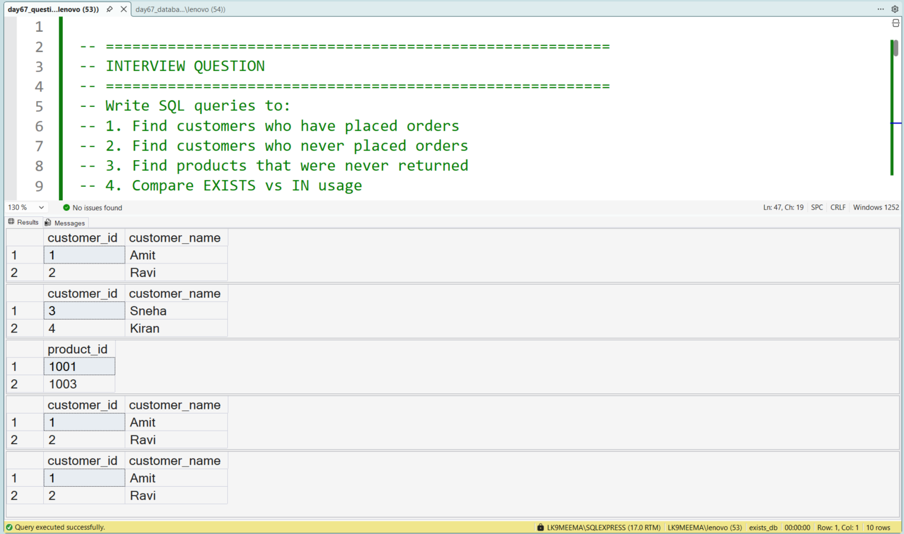
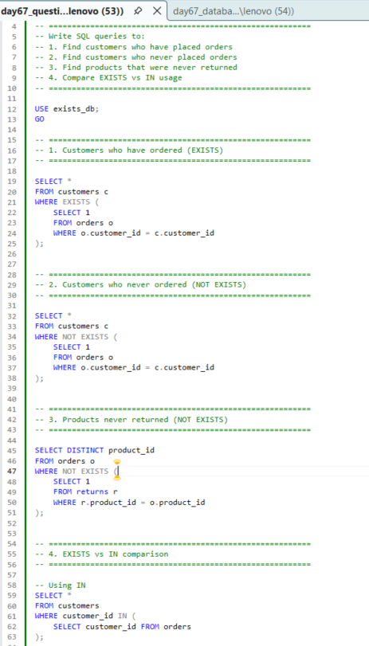

# Using EXISTS and NOT EXISTS in SQL

## Business Scenario

A business needs to identify records that have related records and records that do not.

## Analysis Objective

Use EXISTS and NOT EXISTS to test whether matching records are present.

## SQL Concepts Practiced

- EXISTS
- NOT EXISTS
- Correlated subqueries
- Existence checks
- Anti-joins

## Query and Setup

- [database_table_setup.sql](database_table_setup.sql) — database and table setup.
- [question_solution_exists.sql](question_solution_exists.sql) — SQL solution.

## Execution Evidence

### Output Result

### Query Execution

## Business Insight

EXISTS and NOT EXISTS are useful for identifying matching and missing relationships without requiring columns from the matching rows in the output.

## Project Files

- [database_table_setup.sql](database_table_setup.sql)
- [output_result.png](output_result.png)
- [query_execution.png](query_execution.png)
- [question_solution_exists.sql](question_solution_exists.sql)

## Tools Used

- Microsoft SQL Server
- SQL Server Management Studio (SSMS)

---

This case study is part of my SQL business-case and interview-practice portfolio.
