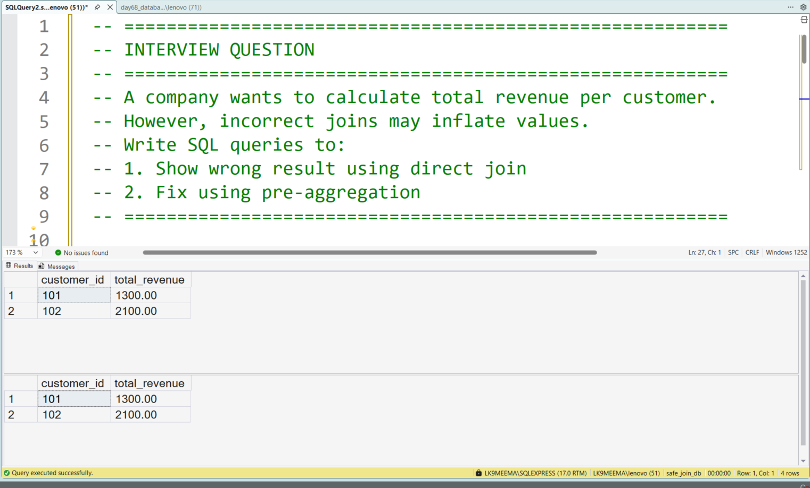
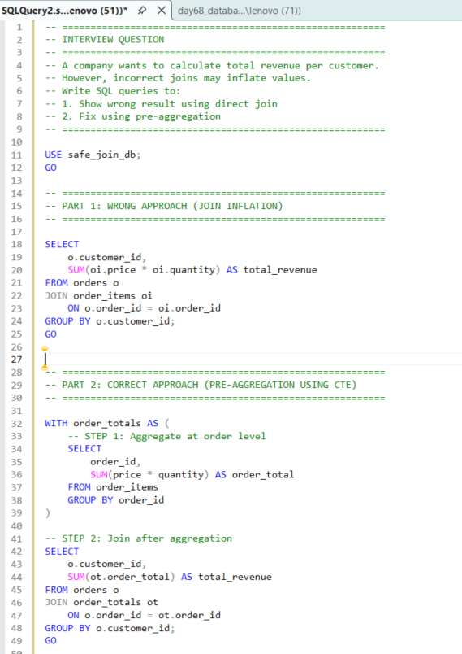

# Safe SQL Joins and Aggregation

## Business Scenario

An analyst must combine business tables without accidentally inflating totals.

## Analysis Objective

Understand join cardinality, duplicate rows, and the correct order of joins and aggregations.

## SQL Concepts Practiced

- INNER JOIN
- LEFT JOIN
- Join cardinality
- GROUP BY
- Duplicate prevention

## Query and Setup

- [database_table_setup.sql](database_table_setup.sql) — database and table setup.
- [question_solution_safe_join.sql](question_solution_safe_join.sql) — SQL solution.

## Execution Evidence

### Output Result

### Query Execution

## Business Insight

Joining tables at incompatible levels of detail can multiply rows and produce incorrect business totals.

## Project Files

- [database_table_setup.sql](database_table_setup.sql)
- [output_result.png](output_result.png)
- [query_execution.png](query_execution.png)
- [question_solution_safe_join.sql](question_solution_safe_join.sql)

## Tools Used

- Microsoft SQL Server
- SQL Server Management Studio (SSMS)

---

This case study is part of my SQL business-case and interview-practice portfolio.
