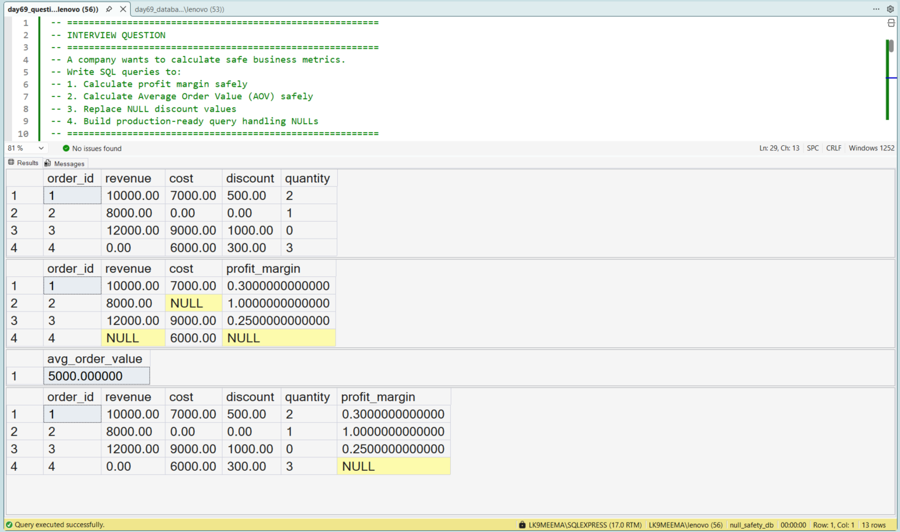
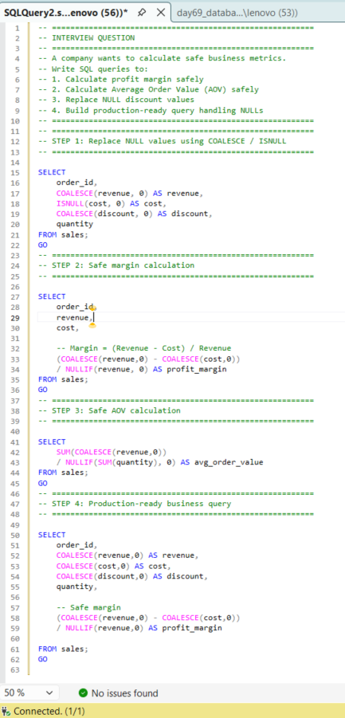

# Handling NULL Values Safely in SQL

## Business Scenario

A business dataset contains missing values that can affect calculations and filtering.

## Analysis Objective

Understand how NULL affects comparisons, aggregations, and conditional logic.

## SQL Concepts Practiced

- NULL
- IS NULL
- IS NOT NULL
- COALESCE()
- NULL-safe filtering

## Query and Setup

- [database_table_setup.sql](database_table_setup.sql) — database and table setup.
- [question_solution_null_safety.sql](question_solution_null_safety.sql) — SQL solution.

## Execution Evidence

### Output Result

### Query Execution

## Business Insight

NULL requires explicit handling because ordinary equality comparisons with NULL do not return TRUE.

## Project Files

- [database_table_setup.sql](database_table_setup.sql)
- [output_result.png](output_result.png)
- [query_execution.png](query_execution.png)
- [question_solution_null_safety.sql](question_solution_null_safety.sql)

## Tools Used

- Microsoft SQL Server
- SQL Server Management Studio (SSMS)

---

This case study is part of my SQL business-case and interview-practice portfolio.
