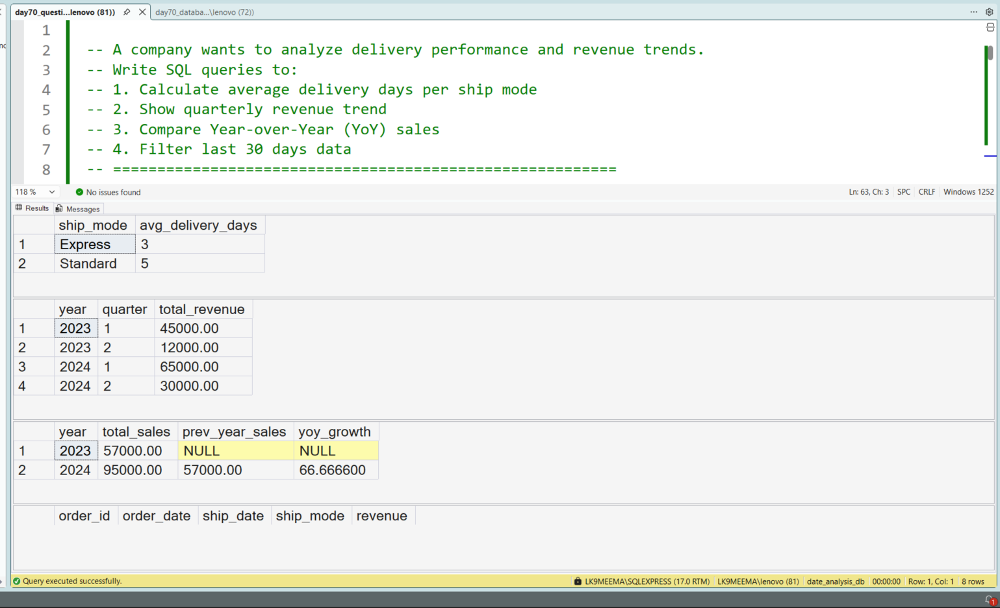
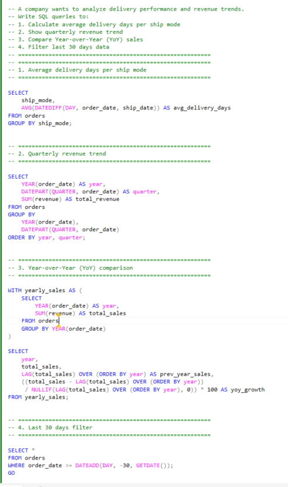

# Business Date Analysis Using SQL

## Business Scenario

A business needs to analyse transactions over dates and reporting periods.

## Analysis Objective

Apply SQL date functions and date filters to business analysis.

## SQL Concepts Practiced

- Date filtering
- Date functions
- Date ranges
- Period-based aggregation
- Time-based analysis

## Query and Setup

- [database_table_setup.sql](database_table_setup.sql) — database and table setup.
- [question_solution_date_analysis.sql](question_solution_date_analysis.sql) — SQL solution.

## Execution Evidence

### Output Result

### Query Execution

## Business Insight

Correct date boundaries and date filtering are essential for reliable daily, monthly, and yearly reporting.

## Project Files

- [database_table_setup.sql](database_table_setup.sql)
- [output_result.png](output_result.png)
- [query_execution.png](query_execution.png)
- [question_solution_date_analysis.sql](question_solution_date_analysis.sql)

## Tools Used

- Microsoft SQL Server
- SQL Server Management Studio (SSMS)

---

This case study is part of my SQL business-case and interview-practice portfolio.
