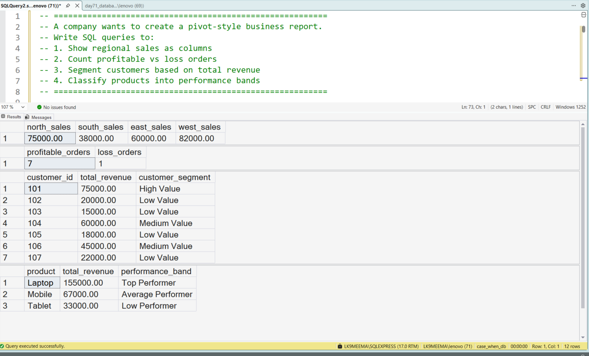
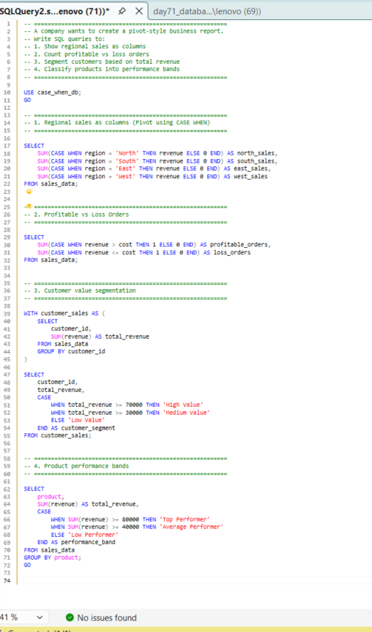

# Conditional Aggregation and Pivot Analysis Using SQL

## Business Scenario

A business wants to summarise measures across different categories in a single result.

## Analysis Objective

Use CASE WHEN and conditional aggregation to transform categories into report columns.

## SQL Concepts Practiced

- CASE WHEN
- Conditional aggregation
- SUM with CASE
- GROUP BY
- Pivot-style reporting

## Query and Setup

- [database_table_setup.sql](database_table_setup.sql) — database and table setup.
- [question_solution_case_when_pivot.sql](question_solution_case_when_pivot.sql) — SQL solution.

## Execution Evidence

### Output Result

### Query Execution

## Business Insight

Conditional aggregation can produce category-based summaries without requiring a separate query for every category.

## Project Files

- [database_table_setup.sql](database_table_setup.sql)
- [output_result.png](output_result.png)
- [query_execution.png](query_execution.png)
- [question_solution_case_when_pivot.sql](question_solution_case_when_pivot.sql)

## Tools Used

- Microsoft SQL Server
- SQL Server Management Studio (SSMS)

---

This case study is part of my SQL business-case and interview-practice portfolio.
