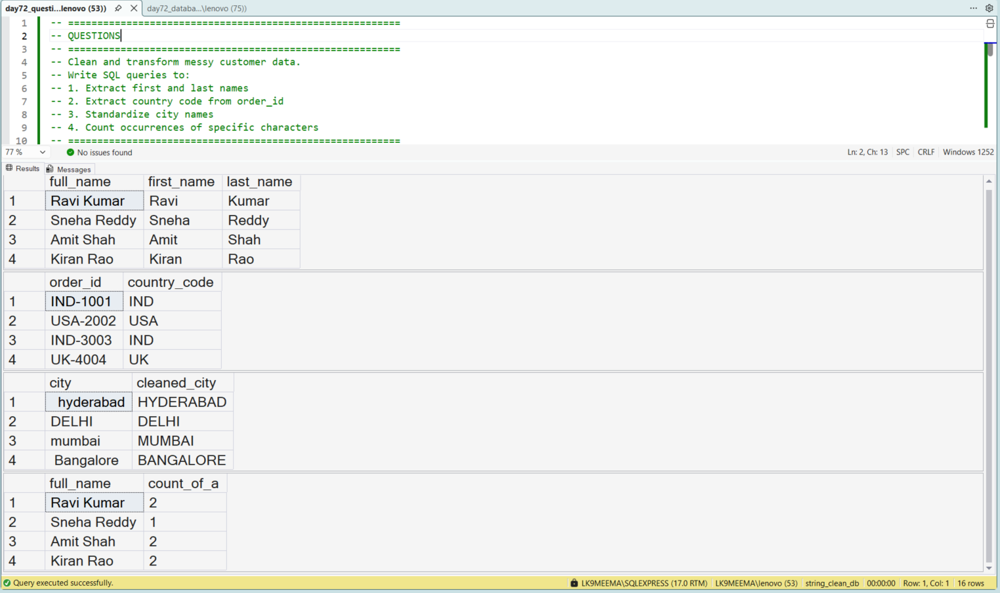
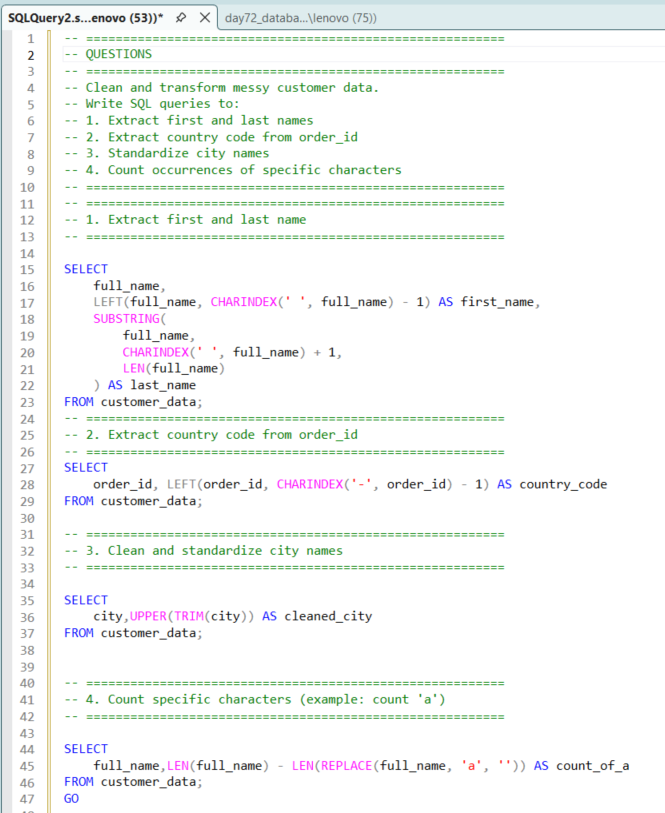

# Cleaning and Standardising Text Data Using SQL

## Business Scenario

A dataset contains inconsistent text values that make grouping and matching unreliable.

## Analysis Objective

Apply SQL string functions to clean and standardise text fields.

## SQL Concepts Practiced

- TRIM()
- UPPER()
- LOWER()
- REPLACE()
- String manipulation

## Query and Setup

- [database_table_setup.sql](database_table_setup.sql) — database and table setup.
- [question_solution_string_cleaning.sql](question_solution_string_cleaning.sql) — SQL solution.

## Execution Evidence

### Output Result

### Query Execution

## Business Insight

Standardising text can reduce inconsistent categories and improve data quality during analysis.

## Project Files

- [database_table_setup.sql](database_table_setup.sql)
- [output_result.png](output_result.png)
- [query_execution.png](query_execution.png)
- [question_solution_string_cleaning.sql](question_solution_string_cleaning.sql)

## Tools Used

- Microsoft SQL Server
- SQL Server Management Studio (SSMS)

---

This case study is part of my SQL business-case and interview-practice portfolio.
