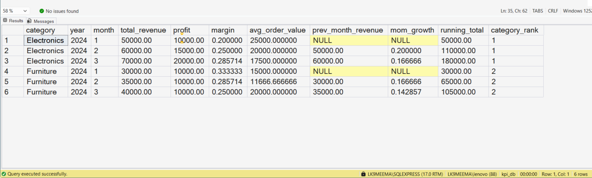
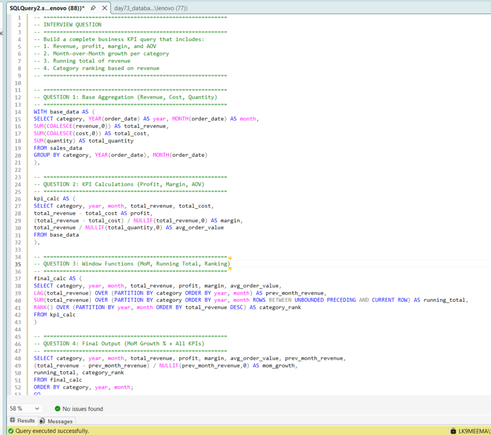

# Building Business KPI Queries Using SQL

## Business Scenario

A business wants to calculate key performance indicators from transactional data.

## Analysis Objective

Combine filtering, aggregation, conditional logic, and other relevant SQL techniques to calculate business metrics.

## SQL Concepts Practiced

- Business KPIs
- Aggregations
- CASE WHEN
- CTEs
- Query validation

## Query and Setup

- [database_table_setup.sql](database_table_setup.sql) — database and table setup.
- [question_solution_kpi_query.sql](question_solution_kpi_query.sql) — SQL solution.

## Execution Evidence

### Output Result

### Query Execution

## Business Insight

A useful KPI query must calculate the intended business metric correctly and make its assumptions clear.

## Project Files

- [database_table_setup.sql](database_table_setup.sql)
- [output_result.png](output_result.png)
- [query_execution.png](query_execution.png)
- [question_solution_kpi_query.sql](question_solution_kpi_query.sql)

## Tools Used

- Microsoft SQL Server
- SQL Server Management Studio (SSMS)

---

This case study is part of my SQL business-case and interview-practice portfolio.
