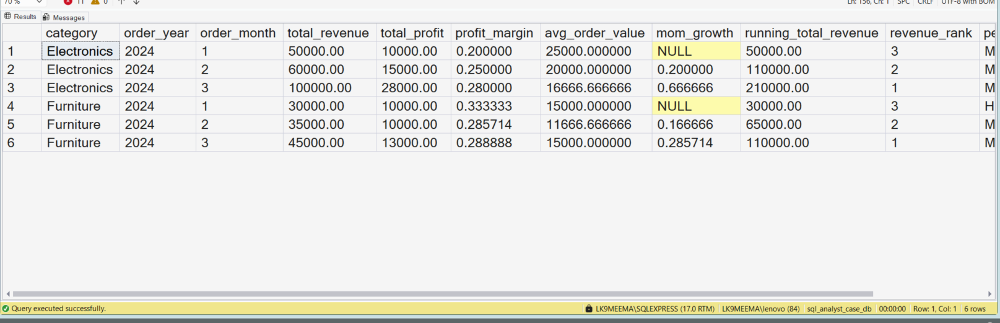
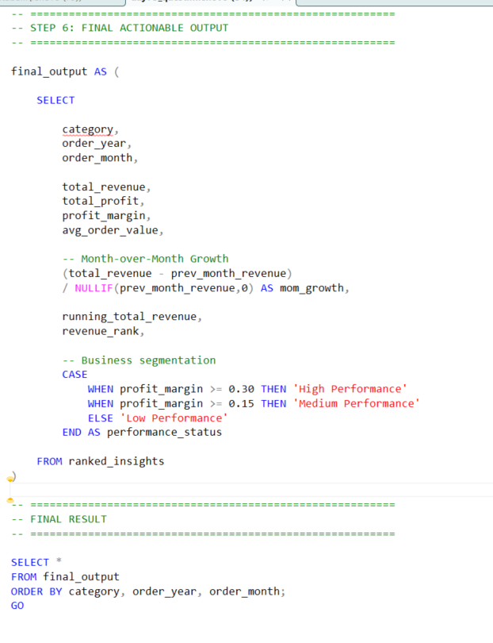

# End-to-End SQL Business Case Study

## Business Scenario

A business problem requires a complete workflow from preparing data to analysing and validating the results.

## Analysis Objective

Apply SQL techniques to solve a business problem and document the analytical process.

## SQL Concepts Practiced

- Data preparation
- SQL querying
- Business logic
- Result validation
- Analytical reasoning

## Query and Setup

- [database_table_setup.sql](database_table_setup.sql) — database and table setup.
- [question_solution_end_to_end_case.sql](question_solution_end_to_end_case.sql) — SQL solution.

## Execution Evidence

### Output Result

### Query Execution

## Business Insight

A strong case study demonstrates not only the query but also the business problem, assumptions, and validation of the result.

## Project Files

- [database_table_setup.sql](database_table_setup.sql)
- [output_result.png](output_result.png)
- [query_execution.png](query_execution.png)
- [question_solution_end_to_end_case.sql](question_solution_end_to_end_case.sql)

## Tools Used

- Microsoft SQL Server
- SQL Server Management Studio (SSMS)

---

This case study is part of my SQL business-case and interview-practice portfolio.
